  

  

  

<h3 align="center">🤝 Let's connect</h3>

  🏅 <a href="https://www.kaggle.com/munalsingh"><b>Kaggle</b></a>
  &nbsp;&nbsp;·&nbsp;&nbsp;
  💼 <a href="https://www.linkedin.com/in/munal-singh-a375a4307"><b>LinkedIn</b></a>
  &nbsp;&nbsp;·&nbsp;&nbsp;
  🧩 <a href="https://leetcode.com/u/t0VTXXovHa/"><b>LeetCode</b></a>
  &nbsp;&nbsp;·&nbsp;&nbsp;
  ✉️ <a href="mailto:munalmax777@gmail.com"><b>munalmax777@gmail.com</b></a>

Open to internships, research collaborations and great conversations.

